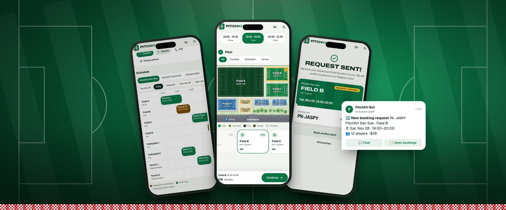
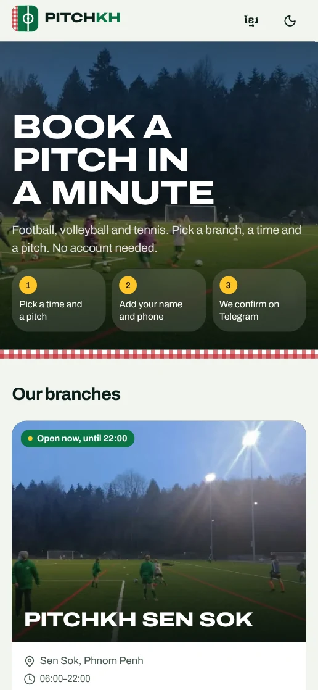
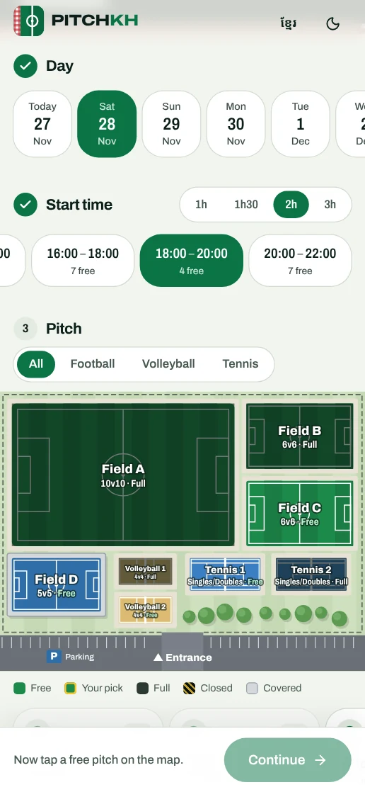
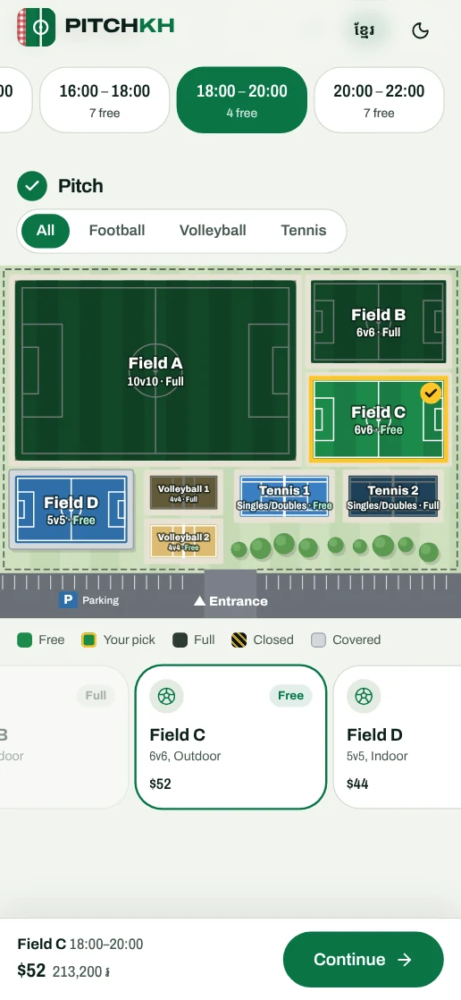
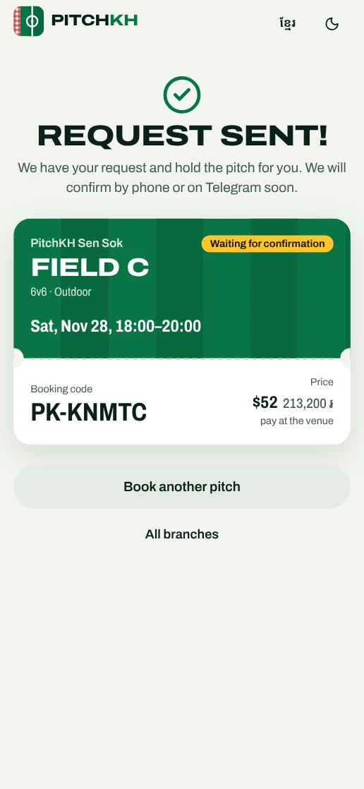
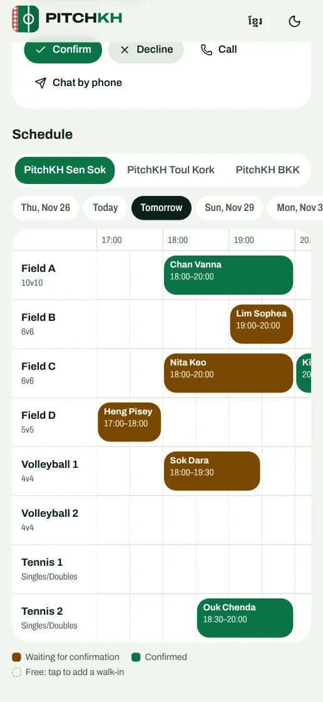
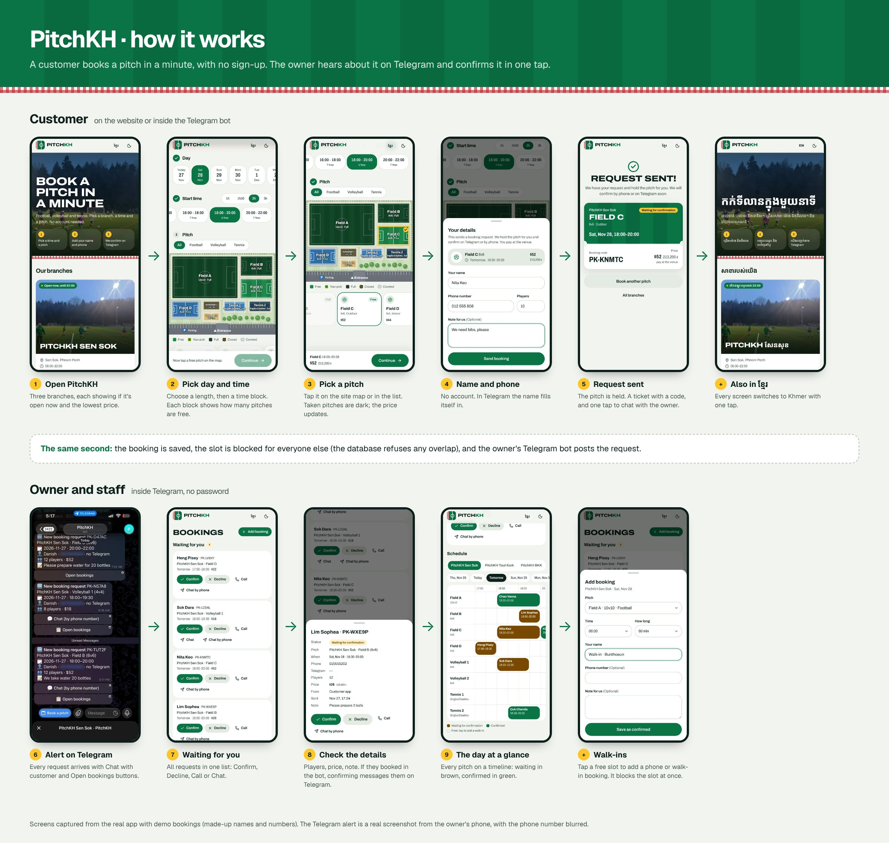

<div align="center">



# PitchKH

**Book a football, volleyball or tennis pitch in Phnom Penh in about a minute.<br/>No sign-up. The owner confirms on Telegram.**

[**Open the app →**](https://pitchkh.vercel.app/en) &nbsp;·&nbsp; [How it works](#how-it-works) &nbsp;·&nbsp; [Run it locally](#run-it-locally) &nbsp;·&nbsp; [Going live](docs/LAUNCH.md)

[](https://github.com/danishsary8/pitchkh/actions/workflows/ci.yml)


</div>

<table>
  <tr>
    <td width="20%"></td>
    <td width="20%"></td>
    <td width="20%"></td>
    <td width="20%"></td>
    <td width="20%"></td>
  </tr>
  <tr>
    <td align="center"><sub>Pick a branch</sub></td>
    <td align="center"><sub>Pick a time block</sub></td>
    <td align="center"><sub>Tap a pitch on the map</sub></td>
    <td align="center"><sub>Request sent</sub></td>
    <td align="center"><sub>The owner's day</sub></td>
  </tr>
</table>

## Why

Booking a pitch in Phnom Penh usually means messaging the owner and waiting for a reply. Nobody
can see which pitches are free, two teams can be promised the same slot, and the owner runs the
day from a chat history.

PitchKH puts it in one place: customers see what's free and book in a minute, the owner gets every
request on Telegram, and the day's pitches sit on one timeline. It runs as a website and as a
**Telegram Mini App**, in **English and Khmer**.

## How it works

### For customers

| | Step | What happens |
|:-:|---|---|
| 1 | **Pick a branch** | Three branches, each showing whether it's open now and the lowest price. |
| 2 | **Pick a day and a time** | Today and the next 13 days. Choose 1h, 1h30, 2h or 3h; the times become back-to-back blocks (2h: 06:00–08:00, 08:00–10:00 …) with how many pitches are free in each. |
| 3 | **Tap a pitch** | On a top-down plan of the venue or in the cards below it. Taken pitches are dark, and the price for that time shows at once. |
| 4 | **Name and phone** | Plus players and an optional note. No account; inside Telegram the name fills itself in. |
| 5 | **Request sent** | The pitch is held. A ticket with a booking code, pay at the venue, and one tap to message the owner on Telegram. |

### At the same moment

The booking is saved and the slot is blocked for everyone else. **The database itself refuses two
live bookings on the same pitch at overlapping times**, so a double booking can't happen even if
two people tap at the same second. The bot then posts the request to the owner.

### For the owner and staff (inside Telegram, no password)

| | Step | What happens |
|:-:|---|---|
| 6 | **Alert on Telegram** | Each request arrives as a bot message with **Chat with customer** and **Open bookings** buttons. |
| 7 | **Waiting for you** | Every open request in one list: Confirm, Decline, Call or Chat. |
| 8 | **Confirm** | The customer gets a Telegram message if they booked in the bot. |
| 9 | **The day at a glance** | Each branch's pitches on a timeline; tap a free slot to add a walk-in or phone booking. |

Staff are recognised by the identity Telegram signs for the Mini App, checked against a list of
Telegram IDs, so there is nothing to log in to.

<p align="center"></p>

## Features

- **Site map booking.** Each branch is drawn to scale: a 10v10 pitch, two 6v6, an indoor 5v5 hall, two volleyball and two tennis courts.
- **Fixed time blocks** of 1h, 1h30, 2h or 3h, so the schedule has no awkward gaps.
- **Evening pricing** from 17:00, worked out per half hour, in US dollars with riel shown.
- **No double bookings,** enforced by a PostgreSQL exclusion constraint, not just by the app.
- **Telegram everywhere:** Mini App, booking alerts with chat buttons, confirmation messages, and a ready-made message from customer to owner.
- **Staff screen:** waiting list, booking details, day timeline per branch, walk-ins, call and chat in one tap.
- **English and Khmer** on every screen; light by default, with a dark mode.
- **Phone first:** built and checked at 360px wide.

## Tech stack

| Area | Choice |
|---|---|
| App | Next.js 16 (App Router), React 19, TypeScript (strict) |
| UI | Tailwind CSS 4, Radix primitives, an SVG site-map renderer |
| Data | PostgreSQL on Neon (serverless driver); in-memory store for local development |
| Validation | zod schemas shared by the form and the API |
| Messaging | Telegram Bot API and Telegram Mini Apps |
| Languages | next-intl, English and Khmer |
| Tests | Vitest: unit tests and API-route tests |
| Hosting | Vercel (Singapore region) + Neon (Singapore) |

## Project structure

```
apps/web/
  src/app/                 pages (home, branch, admin, terms, privacy) and the REST API
  src/app/api/             availability, bookings, staff and health endpoints
  src/features/book/       customer screens: home, day / time / pitch pickers, summary, form, ticket
  src/features/staff/      staff screens: requests, booking sheet, day timeline, walk-ins
  src/features/pitch-map/  the venue site map
  src/lib/                 branches, booking rules, availability, typed API client
  src/server/              database store, Telegram identity checks, bot messages
  db/schema.sql            database schema (applied automatically on start-up)
packages/shared/           shared types, pitch layout, pricing helpers, translations
portfolio/                 screenshots, covers and the portfolio entry for this project
```

**To change branches, pitches, hours or prices,** edit `apps/web/src/lib/branches.ts`.

## REST API

| Method and path | Who | What |
|---|---|---|
| `GET /api/branches/:slug/taken?date=` | anyone | Which pitches are taken when (no personal data) |
| `POST /api/bookings` | anyone | Ask for a pitch; saved as waiting. `409` if the slot was just taken |
| `GET /api/admin/me` | staff | Whether this Telegram user may open the staff screen |
| `GET /api/admin/bookings?branch=&date=` | staff | A day's bookings plus every waiting request |
| `POST /api/admin/bookings` | staff | Walk-in or phone booking, confirmed at once |
| `PATCH /api/admin/bookings/:id` | staff | Confirm, cancel or restore |
| `GET /api/health` | anyone | Database, bot and staff setup at a glance |

Staff requests carry the signed Telegram Mini App data in `x-telegram-init-data`. Errors are JSON:
`{ "error": "<code>" }`. Booking requests are rate-limited per address.

## Run it locally

Requires Node 20+ and pnpm.

```bash
pnpm install
pnpm dev
```

Open <http://localhost:3000>. Without a database or bot token, bookings are kept in memory and
`/admin` is open on your own machine, so you can try every screen.

```bash
pnpm test    # unit and API-route tests
pnpm check   # translations, types, lint, tests and the production build (same as CI)
```

### Environment variables

Copy `apps/web/.env.example` to `apps/web/.env.local` and fill in what you need:

| Name | Where | What |
|---|---|---|
| `DATABASE_URL` | server | Postgres connection string (Neon). Without it, bookings live in memory. |
| `TELEGRAM_BOT_TOKEN` | server | Your bot's token from @BotFather: verifies Mini App users and sends alerts. |
| `ADMIN_TELEGRAM_IDS` | server | Telegram IDs allowed into `/admin`, comma-separated. |
| `NEXT_PUBLIC_OWNER_TELEGRAM` | public | Username for the "Chat with us on Telegram" button. |
| `NEXT_PUBLIC_SITE_URL` | public | The site's address, used in bot messages and link previews. |

Setting it up for real (bot, database, Vercel) is covered step by step in
[docs/LAUNCH.md](docs/LAUNCH.md).

## Quality

- **104 automated tests** (71 web + 33 shared), including every API route against the in-memory store.
- **Typed end to end:** the booking form validates with the same zod schema as the API.
- **Safety:** staff identity checked with Telegram's HMAC signature, size limits and rate limits
  on requests, no personal data in public endpoints, and security headers on every page.
- **CI** runs the translation check, types, lint, tests and the build on every push.

## Credits

Photos are freely licensed; see the in-app **Photo credits** page. The branch details are sample
data until the real ones are added.

<div align="center"><sub>Made in Phnom Penh 🇰🇭</sub></div>
