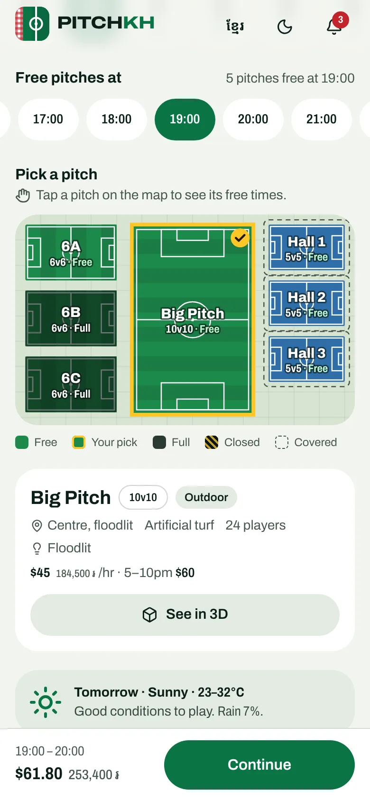
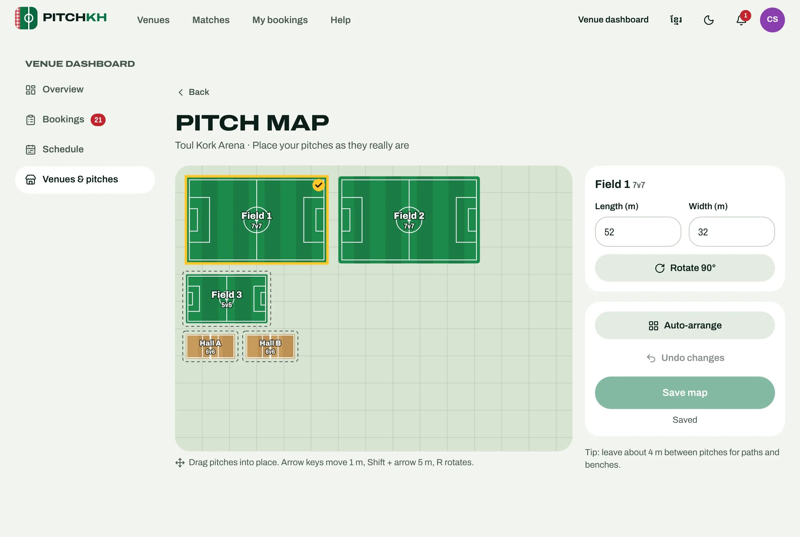
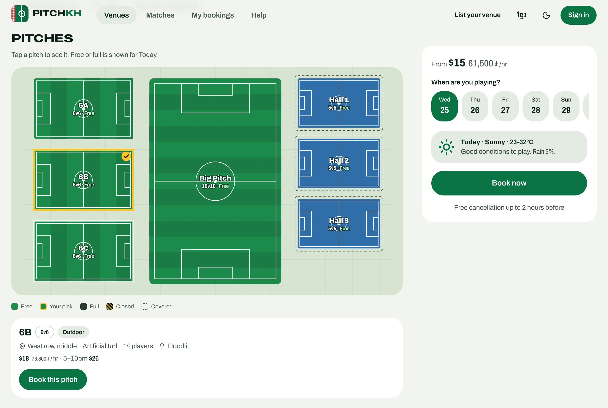

# PitchKH

**Book a football, volleyball or tennis pitch anywhere in Cambodia, and find a team to play against.**

[](https://github.com/danishsary8/pitchkh/actions/workflows/ci.yml)
&nbsp;Next.js 16 · React 19 · TypeScript · Tailwind CSS v4 · Telegram

**Try it:** live demo (link added after deploy, see [Deploy the demo](#deploy-the-demo)). On the sign-in page,
one tap logs you in as a **player**, a **venue owner** or an **admin**; the demo runs on sample data and
payments are simulated.

Players open a venue, *see its real layout on a pitch map*, tap a pitch and a time,
and pay in two screens. Venue owners draw their venue's map, answer booking requests
(also from Telegram) and manage prices. Admins approve venues and handle reports.
English and Khmer, light and dark, phone first.

This repo is the **web app**. It runs entirely in the browser on demo data, with no
server or database, and bookings are arranged with the venue owner **on Telegram**.
A real backend is a [future plan](#future-plan-backend).


### Players

<table>
  <tr>
    <td width="33%"></td>
    <td width="33%"></td>
    <td width="33%"></td>
  </tr>
  <tr>
    <td align="center"><sub>Find a pitch, tap a free time</sub></td>
    <td align="center"><sub>① Pick a pitch on the map and a time</sub></td>
    <td align="center"><sub>② Confirm</sub></td>
  </tr>
  <tr>
    <td></td>
    <td></td>
    <td></td>
  </tr>
  <tr>
    <td align="center"><sub>Pay with KHQR (slot held 10 min)</sub></td>
    <td align="center"><sub>Booked: the ticket</sub></td>
    <td align="center"><sub>Your next game on Home</sub></td>
  </tr>
</table>

### Venue owners and admins

<table>
  <tr>
    <td width="33%"></td>
    <td width="33%"></td>
    <td width="33%"></td>
  </tr>
  <tr>
    <td align="center"><sub>Answer booking requests</sub></td>
    <td align="center"><sub>The day's schedule</sub></td>
    <td align="center"><sub>Khmer, dark mode</sub></td>
  </tr>
</table>

<table>
  <tr>
    <td width="50%"></td>
    <td width="50%"></td>
  </tr>
  <tr>
    <td align="center"><sub>Owners draw their venue's pitch map</sub></td>
    <td align="center"><sub>Admin analytics</sub></td>
  </tr>
</table>

## Engineering highlights

- **One API contract, ready for a backend.** The UI only calls `api.*` (TanStack Query → typed
  client). Today a built-in mock server answers in the browser, validating with the same zod
  schemas a real backend will use; switching later is one environment variable.
- **Booking by Telegram, no server needed.** "Ask on Telegram" sends the chosen pitch, time,
  players and price to the owner's chat; matches are shared to a Telegram group.
- **A pitch map that looks like the real site:** balanced rows, paved borders, roofs over
  indoor courts, trees, fence, car park and entrance, drawn from real pitch sizes.
- **Bilingual and phone-first:** 874 UI strings in English and Khmer with type-checked keys, light
  and dark themes, 44 px touch targets, reduced motion respected, installable PWA.
- **Tested:** unit tests for the shared rules, mock API, pitch layout and Telegram links, a
  Playwright booking run on a phone screen, a screenshot check at five widths, and CI on every push.

The full story (problem, how it was built, numbers) is in [`docs/CASE_STUDY.md`](docs/CASE_STUDY.md).

---

## Contents

1. [Quick start](#quick-start)
2. [Deploy the demo](#deploy-the-demo)
3. [What you can do](#what-you-can-do)
4. [The booking flow](#the-booking-flow)
5. [The pitch map](#the-pitch-map)
6. [How the code is organised](#how-the-code-is-organised)
7. [Tech stack](#tech-stack)
8. [Scripts and checks](#scripts-and-checks)
9. [Future plan: backend](#future-plan-backend)
10. [Roadmap](#roadmap)
11. [Notes](#notes)

---

## Quick start

You need **Node 20+** and **pnpm 10**.

```bash
pnpm install
```

```bash
pnpm dev
```

Open http://localhost:3000, go to **Sign in**, and tap a demo account:

| Role | Email | Password | Try this |
| --- | --- | --- | --- |
| Player | dara@pitchkh.app | password | Book a pitch at *Chbar Ampov Football City*, post a match, chat |
| Venue owner | sophea@pitchkh.app | password | **Venues & fields → Pitch map** to drag pitches around, accept requests |
| Admin | admin@pitchkh.app | password | Approve venues, feature them, handle reports |

All demo data lives in your browser's `localStorage`. Reset it from
**Profile → Demo data → Reset**.

> **Tip:** *Chbar Ampov Football City* is the showcase venue: three 6-a-side
> pitches, one big 10-a-side pitch and a covered hall with three 5-a-side courts.

---

## Deploy the demo

The public demo is the web app alone, on its built-in mock API: no server, database or keys.

1. [Vercel](https://vercel.com) → **Add New → Project** → import this repo.
2. **Root Directory:** `apps/web`. Vercel then reads `apps/web/vercel.json` (Next.js, pnpm
   workspace install, Singapore region). Leave "Include files outside the root directory" on.
3. Environment variables: leave `NEXT_PUBLIC_API_MODE` unset (mock is the default) and set
   `NEXT_PUBLIC_SITE_URL` to the Vercel URL once you know it (link previews use it).
   Set `NEXT_PUBLIC_TELEGRAM_GROUP_URL` to your Telegram group's invite link (the match board
   links to it; until then it points to a placeholder).
4. Deploy. Visitors see a "Demo" bar with **Reset demo**, and one-tap demo logins on the
   sign-in page. Sample data is kept in the browser and refreshes itself after a while.


---

## What you can do

| Area | Features |
| --- | --- |
| **Find a venue** | Browse with filters (sport, area, price, free at a time), sort, list or map view, favourites. Compact cards show pitch sizes ("3 × 6v6") and the **next free times as one-tap chips** |
| **Home** | Signed in: **your next game** with a live countdown, directions and *Share with team*; a **Play again** row of venues you booked before |
| **Venue page** | Photos, **pitch map** with free/full per day, 3D look-around of each pitch, prices, amenities, hours, location, weather hint, reviews, report |
| **Booking** | **2 screens**: pick pitch + time → confirm + pay (mock KHQR / ABA / Wing / cash). A ticket-style receipt with a stamp and confetti, **share to Telegram** (or any app through the phone's share sheet), add to calendar, cancel or reschedule up to 2 h before, **Book again** |
| **Matches** | Football and volleyball match board, post a game, ask to join, accept/decline, team profiles with sportsmanship ratings, chat |
| **Player area** | Bookings, favourites, matches, reviews, notifications, messages, team, profile |
| **Owner dashboard** | Earnings, booking requests, day schedule with blocked time, venues and pitches, per-pitch pricing, **pitch map editor**, **booking alerts in Telegram** (accept or decline cash requests from the chat) |
| **Admin panel** | Analytics, venue approval, featured venues, users, reports |
| **Everywhere** | English and Khmer, light and dark theme, works from 360 px phones to desktops, installable PWA with an offline page |

---

## The booking flow

Before: **Field → Time → Details → Pay** (4 screens, pitches as a text list).
Now: **2 screens**, and you choose pitches by *seeing* them.

```
Venue page ──► ① Pick                                   ② Confirm & pay
               ┌──────────────────────────────┐        ┌──────────────────────────┐
               │ Sport chips (if > 1 sport)   │        │ Summary + mini map       │
               │ Day strip                    │        │ "Have / find opponent"   │
               │ Start time chips  ◄─ time    │        │ Players & extras (folded)│
               │ PITCH MAP         ◄─ pitch   │ ─────► │ Payment method           │
               │ Pitch card (+ See in 3D)     │        │ [ Pay $X ]               │
               │ Slot grid (start → end)      │        └──────────────────────────┘
               └──────────────────────────────┘
```

The fastest path skips the venue page: tap a time chip such as **19:00** on a
venue card and screen ① opens with that start time already picked.

Two ways to choose on screen ①:

- **Pitch first:** tap a pitch on the map and its free times appear below.
- **Time first:** tap a start time (e.g. *19:00*). The map shows which pitches
  are free then ("5 pitches free at 19:00"), and tapping one pre-fills that game.

A venue with only one pitch skips the map. The draft is kept in
`sessionStorage`, so it survives signing in halfway through.

---

## The pitch map



**Data.** Each pitch (`Field`) has a `layout`: a rectangle on the venue's plan,
in metres.

```json
{ "name": "Big Pitch", "format": "10v10", "layout": { "x": 46, "y": 4, "w": 48, "h": 75 } }
```

- `x, y` = top-left corner, `w, h` = size. `h > w` means the pitch is drawn vertically.
- `layout: null` = not placed yet. The app auto-arranges it by size.

**Logic** (`packages/shared/src/domain/layout.ts`, unit-tested):

| Function | What it does |
| --- | --- |
| `pitchSize(sport, format)` | Real size, e.g. 6v6 = 36 × 22 m, 10v10 = 75 × 48 m, tennis = 23.77 × 10.97 m |
| `autoLayout(fields)` | Packs pitches into rows, grouped by sport, biggest first |
| `resolveLayout(fields)` | Saved layouts + auto-placed ones for the rest |
| `findLayoutOverlap(items)` | Returns two overlapping pitches, or `null` |
| `planBounds(layouts)` | Size of the drawing |

**UI** (`apps/web/src/features/pitch-map`): an SVG drawing with real court lines and
surface colours. Each pitch is a radio button, so it works with a keyboard
(Tab, Enter) and screen readers ("6B, 6v6, Full").

**Owner editor** (`/owner/venues/:id/layout`): drag pitches (1 m snap), arrow keys
move 1 m (Shift = 5 m), **R** rotates, type the length/width, **Auto-arrange**,
**Save**. Overlapping pitches turn red and block saving.

---

## How the code is organised

```
pitchkh/
├─ apps/
│  ├─ web/                    Next.js app (this is what runs)
│  │  ├─ src/app/[locale]/    thin route files: /en/..., /km/...
│  │  ├─ src/features/        one folder per feature
│  │  │  ├─ booking/          2-screen flow: step-pick, step-confirm, payment, slot grid
│  │  │  ├─ pitch-map/        SVG map, pitch drawing, availability helpers
│  │  │  ├─ venues/ owner/ admin/ matches/ chat/ account/ auth/ home/ field3d/ ...
│  │  ├─ src/components/      UI kit (buttons, sheets...), layout, brand
│  │  └─ scripts/             e2e test, screenshots, asset renderer, lighthouse
│  └─ mobile/                 placeholder for the React Native app
├─ packages/shared/           used by web (and later mobile and the backend)
│  ├─ schemas/                zod schemas = the exact JSON shapes of the API
│  ├─ domain/                 pure logic: slots, prices, layout, time, rules (+ tests)
│  ├─ api/                    typed API client (mock or real HTTP)
│  ├─ mock/                   in-memory mock server + seed data
│  └─ i18n/                   en.json, km.json
└─ docs/                      architecture, mobile plan; future-backend/ holds the API contract
```

**The one rule:** UI → TanStack Query → `api.*` service → transport → *(mock server | HTTP)*.
Components never touch mock data, so switching to the real backend is one env var.
Details in [`docs/ARCHITECTURE.md`](docs/ARCHITECTURE.md).

---

## Tech stack

| Layer | Choice |
| --- | --- |
| Framework | Next.js 16 (App Router), React 19, TypeScript (strict) |
| Styling | Tailwind CSS v4, Radix primitives (shadcn-style), `motion` for animation |
| Data | TanStack Query (server state), zustand (booking draft), zod (validation) |
| i18n | next-intl, English + Khmer (key parity checked by `scripts/i18n-merge.mjs`) |
| Maps and 3D | SVG pitch map, Leaflet + OpenStreetMap, three.js (lazy-loaded) |
| Backend | None yet: an in-browser mock API (see [Future plan](#future-plan-backend)) |
| Tests | vitest (shared logic + mock API), Playwright e2e and screenshot scripts |
| Monorepo | pnpm workspaces |

---

## Scripts and checks

| Command | What it does |
| --- | --- |
| `pnpm dev` | Run the app at http://localhost:3000 |
| `pnpm typecheck` | TypeScript in every package (translation keys are type-checked too) |
| `pnpm lint` | ESLint |
| `pnpm test` | Unit tests for the shared logic and the mock API |
| `pnpm build` | Production build |
| `pnpm check` | English and Khmer have the same keys, then all four above (CI runs this) |

With a server running (`pnpm build && pnpm start`):

```bash
node apps/web/scripts/e2e-booking.mjs
```

```bash
node apps/web/scripts/screenshots.mjs
```

```bash
node apps/web/scripts/readme-screens.mjs
```

1. **e2e-booking** signs in on a phone viewport, taps a pitch on the map, picks
   times, pays, checks the receipt and cancels.
2. **screenshots** captures key pages at 360–1440 px and fails on horizontal
   overflow or console errors (`--login player|owner|admin`, `--pages /en/owner,...`).
3. **readme-screens** refreshes the images in `docs/images`.

Venue, hero and sport photos are freely licensed (CC BY, CC BY-SA, CC0) and credited
on the in-app **Photo credits** page (`/credits`, data in
`apps/web/src/features/content/photo-credits.json`). To use a venue's own photos,
replace `apps/web/public/assets/venues/<slug>-1.webp` to `-3.webp` and remove that
venue's entries from the credits file. The 3D viewer posters are still rendered from
the three.js scenes (`node apps/web/scripts/render-assets.mjs --only fields`).

```bash
node apps/web/scripts/lighthouse.mjs
```

The second command runs Lighthouse (mobile) against the production server.

---

## Future plan: backend

There is no backend in this version, on purpose: the app is a demo that runs in the
browser, and booking happens in a Telegram chat with the venue owner. Everything a
player sees comes from the built-in mock API in `packages/shared/src/mock`, saved in
the browser's `localStorage`.

**What that means today**

- Each visitor has their own copy of the demo data, so two people can "book" the same slot.
  The owner's reply on Telegram is what really confirms a booking.
- Payments, owner and admin screens are simulated.

**When the backend comes back**, the web app needs no UI changes: every screen talks
to `api.*` services, and one setting switches them from the mock to HTTP.

```bash
NEXT_PUBLIC_API_MODE=real
NEXT_PUBLIC_API_URL=https://<your-api>/api/v1
```

A complete v1 backend was already built (Hono + PostgreSQL + Drizzle: accounts,
bookings with double-booking protection, Bakong KHQR payments, Telegram alerts with
Accept/Decline for owners, photo upload, admin). It was removed from this branch to
keep the demo simple and is kept in git history: `apps/api`, `render.yaml` and
`docker-compose.yml` on `main` (commit `5968298`). To restore it:

```bash
git checkout 5968298 -- apps/api render.yaml docker-compose.yml
```

Its contract, data model, setup checklist and operations guide are in
[`docs/future-backend/`](docs/future-backend/).

---

## Roadmap

- [x] Web frontend on a mock API (players, owners, admins)
- [x] Pitch map that looks like the real site, 2-screen booking, owner map editor
- [x] Real, freely licensed photos
- [x] Book via Telegram (chat with the owner), matches shared to a Telegram group
- [x] Public demo on Vercel
- [ ] Telegram Mini App: open PitchKH inside Telegram from a bot
- [ ] Owners' real phone numbers and photos for each venue
- [ ] Backend (see [Future plan](#future-plan-backend)): shared availability, real payments, owner alerts
- [ ] Mobile app (`apps/mobile`, plan in [`docs/MOBILE_PLAN.md`](docs/MOBILE_PLAN.md)), reusing `packages/shared`

---

## Notes

- Payments are simulated. Nothing is charged.
- Prices are stored in USD; KHR is shown at 4,100 riel per dollar.
- Map tiles come from OpenStreetMap. The weather hint is a seasonal estimate, not a forecast.
- First load stays light: the mock backend, zod and the animation library load on
  demand, and three.js and Leaflet load only when used.
- Design notes for the pitch map: [`docs/superpowers/specs/2026-11-24-pitch-map-booking-design.md`](docs/superpowers/specs/2026-11-24-pitch-map-booking-design.md).
