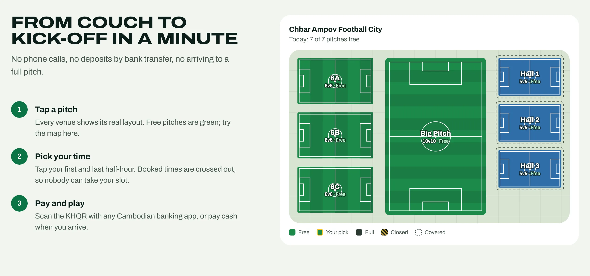
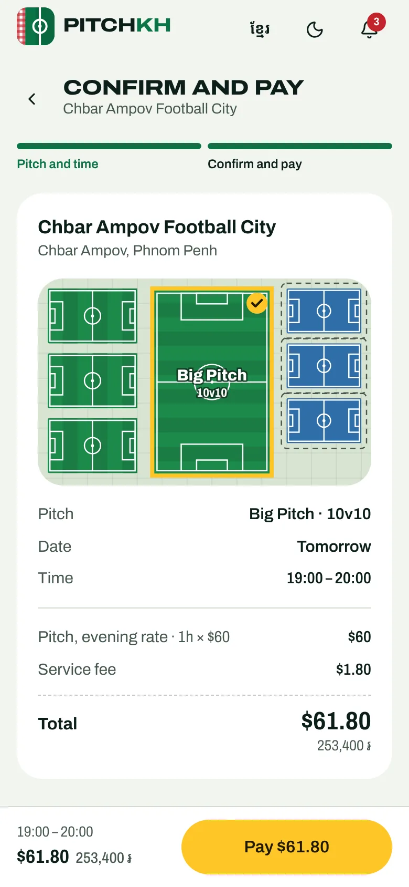
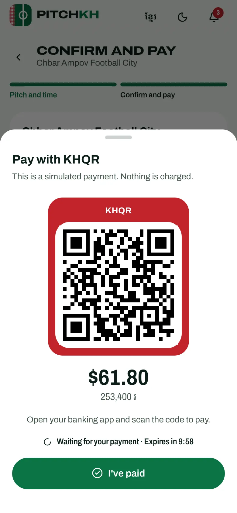
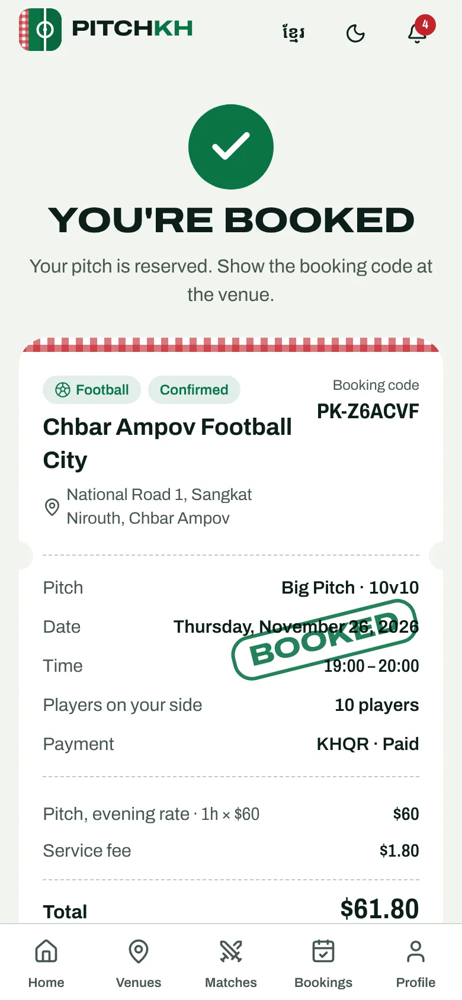
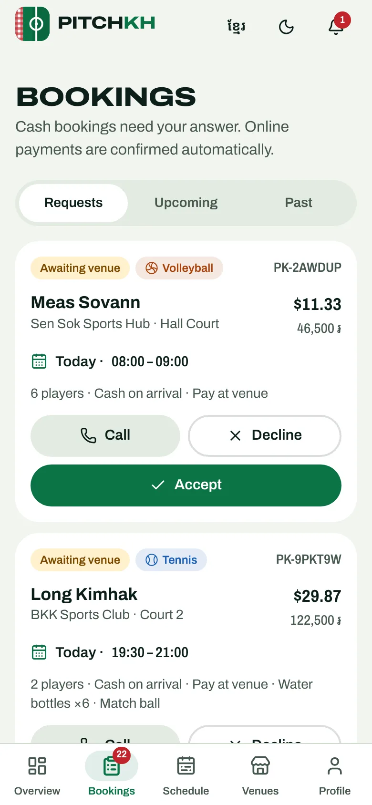
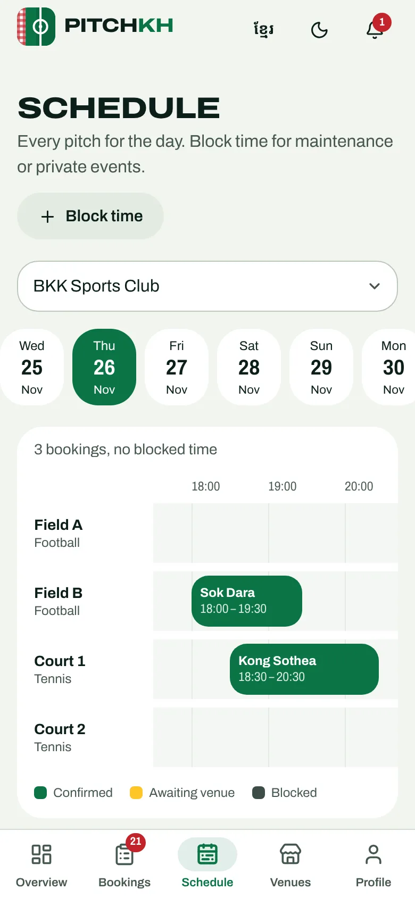
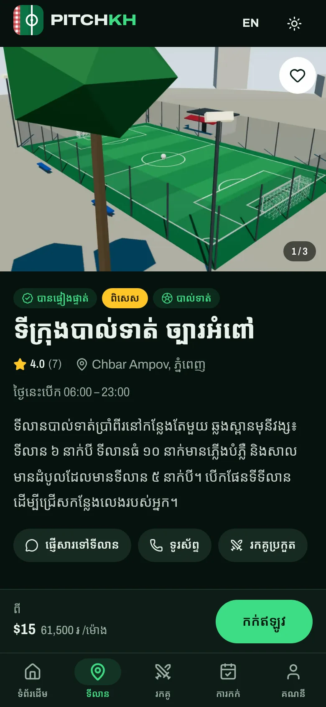
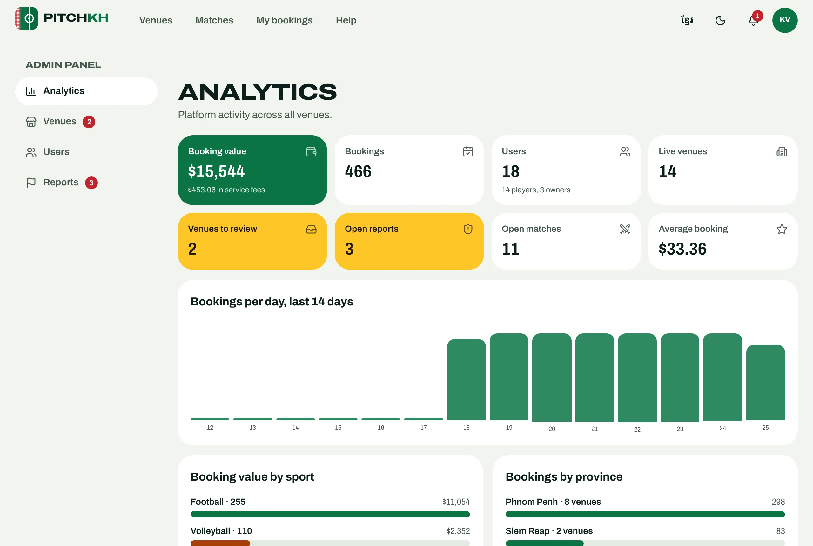

# PitchKH

**Book a football, volleyball or tennis pitch anywhere in Cambodia, and find a team to play against.**

[](https://github.com/danishsary8/pitchkh/actions/workflows/ci.yml)
&nbsp;Next.js 16 · React 19 · TypeScript · Hono · PostgreSQL 16 · Drizzle · Bakong KHQR · Telegram Bot API · Cloudflare R2

**Try it:** live demo (link added after deploy, see [Deploy the demo](#deploy-the-demo)). On the sign-in page,
one tap logs you in as a **player**, a **venue owner** or an **admin**; the demo runs on sample data and
payments are simulated.

Players open a venue, *see its real layout on a pitch map*, tap a pitch and a time,
and pay in two screens. Venue owners draw their venue's map, answer booking requests
(also from Telegram) and manage prices. Admins approve venues and handle reports.
English and Khmer, light and dark, phone first.

This repo holds the **web app** and its **v1 backend**:

- `apps/web` runs on its own with a built-in mock API (the public demo), or
- on the real API in `apps/api` (Node + PostgreSQL) by changing one setting.
  No UI code changes between the two.



### Players

<table>
  <tr>
    <td width="33%"></td>
    <td width="33%"></td>
    <td width="33%"></td>
  </tr>
  <tr>
    <td align="center"><sub>Find a pitch, tap a free time</sub></td>
    <td align="center"><sub>① Pick a pitch on the map and a time</sub></td>
    <td align="center"><sub>② Confirm</sub></td>
  </tr>
  <tr>
    <td></td>
    <td></td>
    <td></td>
  </tr>
  <tr>
    <td align="center"><sub>Pay with KHQR (slot held 10 min)</sub></td>
    <td align="center"><sub>Booked: the ticket</sub></td>
    <td align="center"><sub>Your next game on Home</sub></td>
  </tr>
</table>

### Venue owners and admins

<table>
  <tr>
    <td width="33%"></td>
    <td width="33%"></td>
    <td width="33%"></td>
  </tr>
  <tr>
    <td align="center"><sub>Answer booking requests</sub></td>
    <td align="center"><sub>The day's schedule</sub></td>
    <td align="center"><sub>Khmer, dark mode</sub></td>
  </tr>
</table>

<table>
  <tr>
    <td width="50%"></td>
    <td width="50%"></td>
  </tr>
  <tr>
    <td align="center"><sub>Owners draw their venue's pitch map</sub></td>
    <td align="center"><sub>Admin analytics</sub></td>
  </tr>
</table>

## Engineering highlights

- **No double booking, guaranteed by the database.** A PostgreSQL exclusion constraint
  (`btree_gist`) means two active bookings of one pitch can never overlap. A test sends
  10 players at the same slot at the same moment: exactly one wins, the rest get
  `409 slot_unavailable`.
- **One API contract, two backends.** The UI only calls `api.*` (TanStack Query → typed client).
  A built-in mock server and the real Hono + PostgreSQL API serve the same 72 endpoints and
  validate with the same zod schemas from `packages/shared`. Switching is one environment variable.
- **Real Cambodian payments.** Bakong KHQR: a dynamic QR per booking, the slot is held for
  10 minutes, and the paid status is confirmed with Bakong's API (on each poll and in the
  background every 10 s). Providers sit behind one interface, with a sandbox for tests.
- **Owner alerts in Telegram** with Accept / Decline buttons. Alerts are sent after the booking
  is saved, so a Telegram outage never fails a booking.
- **Security basics done properly:** bcrypt passwords, short-lived JWT access tokens and rotating
  refresh tokens stored as hashes, role checks on every route, signed payment and Telegram
  webhooks, uploads checked by their real file signature (not the label).
- **Photos on Cloudflare R2** (S3 API, SigV4-signed requests), so they survive redeploys on a free
  host; the API only ever deletes files it named itself.
- **Bilingual and phone-first:** 874 UI strings in English and Khmer with type-checked keys, light
  and dark themes, 44 px touch targets, reduced motion respected, installable PWA.
- **Tested:** 25 unit tests for the shared rules, 32 API tests against a real PostgreSQL (booking
  race, payments, and fake Bakong, R2 and Telegram servers), a Playwright booking run on a phone
  screen, and CI on every push.

The full story (problem, how it was built, numbers) is in [`docs/CASE_STUDY.md`](docs/CASE_STUDY.md).

---

## Contents

1. [Quick start](#quick-start)
2. [Deploy the demo](#deploy-the-demo)
3. [What you can do](#what-you-can-do)
4. [The booking flow](#the-booking-flow)
5. [The pitch map](#the-pitch-map)
6. [How the code is organised](#how-the-code-is-organised)
7. [Tech stack](#tech-stack)
8. [Scripts and checks](#scripts-and-checks)
9. [Running on the real backend](#running-on-the-real-backend)
10. [Roadmap](#roadmap)
11. [Notes](#notes)

---

## Quick start

You need **Node 20+** and **pnpm 10**.

```bash
pnpm install
```

```bash
pnpm dev
```

Open http://localhost:3000, go to **Sign in**, and tap a demo account:

| Role | Email | Password | Try this |
| --- | --- | --- | --- |
| Player | dara@pitchkh.app | password | Book a pitch at *Chbar Ampov Football City*, post a match, chat |
| Venue owner | sophea@pitchkh.app | password | **Venues & fields → Pitch map** to drag pitches around, accept requests |
| Admin | admin@pitchkh.app | password | Approve venues, feature them, handle reports |

All demo data lives in your browser's `localStorage`. Reset it from
**Profile → Demo data → Reset**.

> **Tip:** *Chbar Ampov Football City* is the showcase venue: three 6-a-side
> pitches, one big 10-a-side pitch and a covered hall with three 5-a-side courts.

---

## Deploy the demo

The public demo is the web app alone, on its built-in mock API: no server, database or keys.

1. [Vercel](https://vercel.com) → **Add New → Project** → import this repo.
2. **Root Directory:** `apps/web`. Vercel then reads `apps/web/vercel.json` (Next.js, pnpm
   workspace install, Singapore region). Leave "Include files outside the root directory" on.
3. Environment variables: leave `NEXT_PUBLIC_API_MODE` unset (mock is the default) and set
   `NEXT_PUBLIC_SITE_URL` to the Vercel URL once you know it (link previews use it).
   Set `NEXT_PUBLIC_TELEGRAM_GROUP_URL` to your Telegram group's invite link (the match board
   links to it; until then it points to a placeholder).
4. Deploy. Visitors see a "Demo" bar with **Reset demo**, and one-tap demo logins on the
   sign-in page. Sample data is kept in the browser and refreshes itself after a while.

For the real backend instead, follow [`docs/SETUP_CHECKLIST.md`](docs/SETUP_CHECKLIST.md).

---

## What you can do

| Area | Features |
| --- | --- |
| **Find a venue** | Browse with filters (sport, area, price, free at a time), sort, list or map view, favourites. Compact cards show pitch sizes ("3 × 6v6") and the **next free times as one-tap chips** |
| **Home** | Signed in: **your next game** with a live countdown, directions and *Share with team*; a **Play again** row of venues you booked before |
| **Venue page** | Photos, **pitch map** with free/full per day, 3D look-around of each pitch, prices, amenities, hours, location, weather hint, reviews, report |
| **Booking** | **2 screens**: pick pitch + time → confirm + pay (mock KHQR / ABA / Wing / cash). A ticket-style receipt with a stamp and confetti, **share to Telegram** (or any app through the phone's share sheet), add to calendar, cancel or reschedule up to 2 h before, **Book again** |
| **Matches** | Football and volleyball match board, post a game, ask to join, accept/decline, team profiles with sportsmanship ratings, chat |
| **Player area** | Bookings, favourites, matches, reviews, notifications, messages, team, profile |
| **Owner dashboard** | Earnings, booking requests, day schedule with blocked time, venues and pitches, per-pitch pricing, **pitch map editor**, **booking alerts in Telegram** (accept or decline cash requests from the chat) |
| **Admin panel** | Analytics, venue approval, featured venues, users, reports |
| **Everywhere** | English and Khmer, light and dark theme, works from 360 px phones to desktops, installable PWA with an offline page |

---

## The booking flow

Before: **Field → Time → Details → Pay** (4 screens, pitches as a text list).
Now: **2 screens**, and you choose pitches by *seeing* them.

```
Venue page ──► ① Pick                                   ② Confirm & pay
               ┌──────────────────────────────┐        ┌──────────────────────────┐
               │ Sport chips (if > 1 sport)   │        │ Summary + mini map       │
               │ Day strip                    │        │ "Have / find opponent"   │
               │ Start time chips  ◄─ time    │        │ Players & extras (folded)│
               │ PITCH MAP         ◄─ pitch   │ ─────► │ Payment method           │
               │ Pitch card (+ See in 3D)     │        │ [ Pay $X ]               │
               │ Slot grid (start → end)      │        └──────────────────────────┘
               └──────────────────────────────┘
```

The fastest path skips the venue page: tap a time chip such as **19:00** on a
venue card and screen ① opens with that start time already picked.

Two ways to choose on screen ①:

- **Pitch first:** tap a pitch on the map and its free times appear below.
- **Time first:** tap a start time (e.g. *19:00*). The map shows which pitches
  are free then ("5 pitches free at 19:00"), and tapping one pre-fills that game.

A venue with only one pitch skips the map. The draft is kept in
`sessionStorage`, so it survives signing in halfway through.

---

## The pitch map


**Data.** Each pitch (`Field`) has a `layout`: a rectangle on the venue's plan,
in metres.

```json
{ "name": "Big Pitch", "format": "10v10", "layout": { "x": 46, "y": 4, "w": 48, "h": 75 } }
```

- `x, y` = top-left corner, `w, h` = size. `h > w` means the pitch is drawn vertically.
- `layout: null` = not placed yet. The app auto-arranges it by size.

**Logic** (`packages/shared/src/domain/layout.ts`, unit-tested):

| Function | What it does |
| --- | --- |
| `pitchSize(sport, format)` | Real size, e.g. 6v6 = 36 × 22 m, 10v10 = 75 × 48 m, tennis = 23.77 × 10.97 m |
| `autoLayout(fields)` | Packs pitches into rows, grouped by sport, biggest first |
| `resolveLayout(fields)` | Saved layouts + auto-placed ones for the rest |
| `findLayoutOverlap(items)` | Returns two overlapping pitches, or `null` |
| `planBounds(layouts)` | Size of the drawing |

**UI** (`apps/web/src/features/pitch-map`): an SVG drawing with real court lines and
surface colours. Each pitch is a radio button, so it works with a keyboard
(Tab, Enter) and screen readers ("6B, 6v6, Full").

**Owner editor** (`/owner/venues/:id/layout`): drag pitches (1 m snap), arrow keys
move 1 m (Shift = 5 m), **R** rotates, type the length/width, **Auto-arrange**,
**Save**. Overlapping pitches turn red and block saving.

---

## How the code is organised

```
pitchkh/
├─ apps/
│  ├─ web/                    Next.js app (this is what runs)
│  │  ├─ src/app/[locale]/    thin route files: /en/..., /km/...
│  │  ├─ src/features/        one folder per feature
│  │  │  ├─ booking/          2-screen flow: step-pick, step-confirm, payment, slot grid
│  │  │  ├─ pitch-map/        SVG map, pitch drawing, availability helpers
│  │  │  ├─ venues/ owner/ admin/ matches/ chat/ account/ auth/ home/ field3d/ ...
│  │  ├─ src/components/      UI kit (buttons, sheets...), layout, brand
│  │  └─ scripts/             e2e test, screenshots, asset renderer, lighthouse
│  ├─ api/                    v1 backend: Hono + PostgreSQL (routes, SQL migrations, tests)
│  └─ mobile/                 placeholder for the React Native app
├─ packages/shared/           used by web, mobile and (as a reference) the backend
│  ├─ schemas/                zod schemas = the exact JSON shapes of the API
│  ├─ domain/                 pure logic: slots, prices, layout, time, rules (+ tests)
│  ├─ api/                    typed API client (mock or real HTTP)
│  ├─ mock/                   in-memory mock server + seed data
│  └─ i18n/                   en.json, km.json
└─ docs/                      architecture, data model, API contract, mobile plan
```

**The one rule:** UI → TanStack Query → `api.*` service → transport → *(mock server | HTTP)*.
Components never touch mock data, so switching to the real backend is one env var.
Details in [`docs/ARCHITECTURE.md`](docs/ARCHITECTURE.md).

---

## Tech stack

| Layer | Choice |
| --- | --- |
| Framework | Next.js 16 (App Router), React 19, TypeScript (strict) |
| Styling | Tailwind CSS v4, Radix primitives (shadcn-style), `motion` for animation |
| Data | TanStack Query (server state), zustand (booking draft), zod (validation) |
| i18n | next-intl, English + Khmer (key parity checked by `scripts/i18n-merge.mjs`) |
| Maps and 3D | SVG pitch map, Leaflet + OpenStreetMap, three.js (lazy-loaded) |
| Backend | Hono on Node, PostgreSQL 16, Drizzle ORM, JWT (jose), bcrypt, Telegram Bot API |
| Tests | vitest (shared logic + mock API, and API contract tests on PostgreSQL), Playwright e2e script |
| Monorepo | pnpm workspaces |

---

## Scripts and checks

| Command | What it does |
| --- | --- |
| `pnpm dev` | Run the app at http://localhost:3000 |
| `pnpm typecheck` | TypeScript in every package (translation keys are type-checked too) |
| `pnpm lint` | ESLint |
| `pnpm test` | Unit tests for the shared logic and the mock API |
| `pnpm build` | Production build |
| `pnpm check` | English and Khmer have the same keys, then all four above (CI runs this) |

With a server running (`pnpm build && pnpm start`):

```bash
node apps/web/scripts/e2e-booking.mjs
```

```bash
node apps/web/scripts/screenshots.mjs
```

```bash
node apps/web/scripts/readme-screens.mjs
```

1. **e2e-booking** signs in on a phone viewport, taps a pitch on the map, picks
   times, pays, checks the receipt and cancels.
2. **screenshots** captures key pages at 360–1440 px and fails on horizontal
   overflow or console errors (`--login player|owner|admin`, `--pages /en/owner,...`).
3. **readme-screens** refreshes the images in `docs/images`.

Images and 3D posters are rendered from the procedural three.js scenes (no stock
photos). After changing a scene or adding a seed venue:

```bash
node apps/web/scripts/render-assets.mjs --only venues --venue <slug>
```

```bash
node apps/web/scripts/lighthouse.mjs
```

The second command runs Lighthouse (mobile) against the production server.

---

## Going live

Everything that needs **your** accounts (Render, Vercel, Bakong KHQR, Telegram
bot, email, Cloudflare R2) is in one list: [`docs/SETUP_CHECKLIST.md`](docs/SETUP_CHECKLIST.md).
Once live, [`docs/OPERATIONS.md`](docs/OPERATIONS.md) covers logs, health checks, backups,
deploys and rotating keys.

## Running on the real backend

`apps/api` is the v1 backend: **Hono + PostgreSQL + Drizzle**, TypeScript. It
reuses the shared schemas and booking rules, so it behaves exactly like the mock.
Full guide: [`apps/api/README.md`](apps/api/README.md).

```bash
docker compose up -d
```

```bash
cp apps/api/.env.example apps/api/.env
```

```bash
pnpm db:migrate
```

```bash
pnpm db:seed
```

```bash
pnpm api:dev
```

Then point the web app at it in `apps/web/.env.local` and restart `pnpm dev`:

```bash
NEXT_PUBLIC_API_MODE=real
NEXT_PUBLIC_API_URL=http://localhost:8000/api/v1
```

Everything in the app runs on the real API:

| Area | On the real API |
| --- | --- |
| Accounts | Register, sign in (JWT + rotating refresh tokens), **password reset by email link** |
| Booking | Pitch map, availability, **database-level double-booking protection**, cash requests, **online payment flow** (slot held 10 min, signed provider webhook, sandbox provider until real KHQR/ABA keys) |
| Owners | Dashboard, map editor, **venue photo upload**, requests, schedule, earnings, **Telegram alerts with Accept/Decline** |
| Social | Teams, match board, join requests, chat, reviews and ratings |
| Admin | Venue approval, users, reports, analytics |

Run the API tests (they need PostgreSQL):

```bash
pnpm api:test
```

The contract lives in [`docs/API_CONTRACT.md`](docs/API_CONTRACT.md) and the tables in
[`docs/DATA_MODEL.md`](docs/DATA_MODEL.md).

--- | --- | --- |
| GET | `/venues/:idOrSlug/availability?date=` | Slots for every pitch of a venue in one call (colours the map) |
| PUT | `/owner/venues/:id/layout` | Owner saves pitch positions; reject overlaps with `422 validation_failed` |
| – | `fields.layout` (jsonb, nullable) | `{ x, y, w, h }` in metres; reset to `null` when a pitch's sport or format changes |

---

## Roadmap

- [x] Web frontend on a mock API (all roles)
- [x] Pitch map, 2-screen booking, owner map editor
- [x] Real backend v1 (`apps/api`): accounts, venues, bookings, owner, admin, Telegram alerts
- [x] Online payment flow (sandbox provider), photo upload, password reset
- [x] Matches, chat and reviews on the API
- [x] Bakong KHQR payments (real, scannable QR; paid status checked with Bakong)
- [x] Venue photos on Cloudflare R2, public demo mode
- [ ] Public demo on Vercel (mock mode, see [Deploy the demo](#deploy-the-demo))
- [ ] Go live: Render + Vercel + Bakong + Telegram + Resend + R2, following [`docs/SETUP_CHECKLIST.md`](docs/SETUP_CHECKLIST.md)
- [ ] More payment providers (ABA PayWay, Wing)
- [ ] Mobile app (`apps/mobile`, plan in [`docs/MOBILE_PLAN.md`](docs/MOBILE_PLAN.md)), reusing `packages/shared`
- [ ] Real venue photos instead of rendered ones

---

## Notes

- Payments are simulated. Nothing is charged.
- Prices are stored in USD; KHR is shown at 4,100 riel per dollar.
- Map tiles come from OpenStreetMap. The weather hint is a seasonal estimate, not a forecast.
- First load stays light: the mock backend, zod and the animation library load on
  demand, and three.js and Leaflet load only when used.
- Design notes for the pitch map: [`docs/superpowers/specs/2026-11-24-pitch-map-booking-design.md`](docs/superpowers/specs/2026-11-24-pitch-map-booking-design.md).
