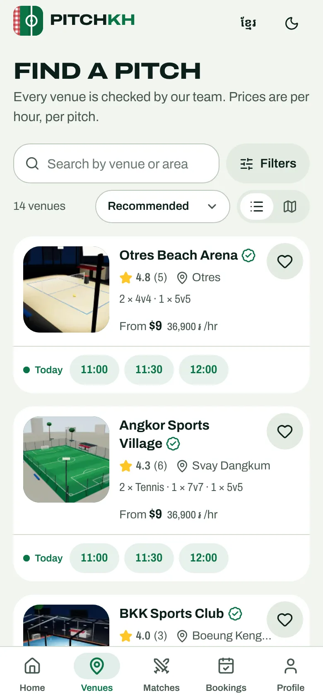
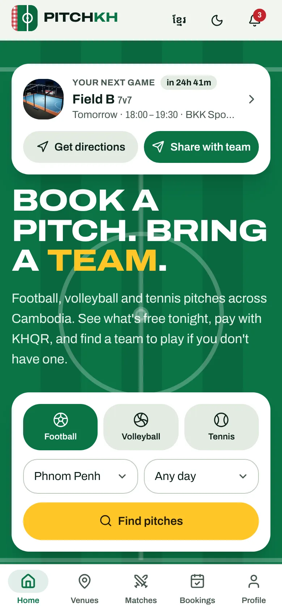

# PitchKH

**Book a football, volleyball or tennis pitch anywhere in Cambodia, and find a team to play against.**

Players open a venue, *see its real layout on a pitch map*, tap a pitch and a time,
and pay in two screens. Venue owners draw their venue's map, manage bookings and
prices. Admins approve venues and handle reports.

This repo is the **complete web frontend**, running on a built-in mock API. The
API, the data model and the mobile app are designed so a real backend can be
plugged in later **without changing any UI code**.

<table>
  <tr>
    <td width="33%"></td>
    <td width="33%"></td>
    <td width="33%"></td>
  </tr>
  <tr>
    <td align="center"><sub>① Pick a pitch and time</sub></td>
    <td align="center"><sub>② Confirm and pay</sub></td>
    <td align="center"><sub>Venue page map</sub></td>
  </tr>
  <tr>
    <td></td>
    <td></td>
    <td></td>
  </tr>
  <tr>
    <td align="center"><sub>Tap a time on a venue card</sub></td>
    <td align="center"><sub>Your next game on Home</sub></td>
    <td></td>
  </tr>
</table>

---

## Contents

1. [Quick start](#quick-start)
2. [What you can do](#what-you-can-do)
3. [The booking flow](#the-booking-flow)
4. [The pitch map](#the-pitch-map)
5. [How the code is organised](#how-the-code-is-organised)
6. [Tech stack](#tech-stack)
7. [Scripts and checks](#scripts-and-checks)
8. [Building the real backend](#building-the-real-backend)
9. [Roadmap](#roadmap)
10. [Notes](#notes)

---

## Quick start

You need **Node 20+** and **pnpm 10**.

```bash
pnpm install
```

```bash
pnpm dev
```

Open http://localhost:3000, go to **Sign in**, and tap a demo account:

| Role | Email | Password | Try this |
| --- | --- | --- | --- |
| Player | dara@pitchkh.app | password | Book a pitch at *Chbar Ampov Football City*, post a match, chat |
| Venue owner | sophea@pitchkh.app | password | **Venues & fields → Pitch map** to drag pitches around, accept requests |
| Admin | admin@pitchkh.app | password | Approve venues, feature them, handle reports |

All demo data lives in your browser's `localStorage`. Reset it from
**Profile → Demo data → Reset**.

> **Tip:** *Chbar Ampov Football City* is the showcase venue: three 6-a-side
> pitches, one big 10-a-side pitch and a covered hall with three 5-a-side courts.

---

## What you can do

| Area | Features |
| --- | --- |
| **Find a venue** | Browse with filters (sport, area, price, free at a time), sort, list or map view, favourites. Compact cards show pitch sizes ("3 × 6v6") and the **next free times as one-tap chips** |
| **Home** | Signed in: **your next game** with a live countdown, directions and *Share with team*; a **Play again** row of venues you booked before |
| **Venue page** | Photos, **pitch map** with free/full per day, 3D look-around of each pitch, prices, amenities, hours, location, weather hint, reviews, report |
| **Booking** | **2 screens**: pick pitch + time → confirm + pay (mock KHQR / ABA / Wing / cash). A ticket-style receipt with a stamp and confetti, **share to Telegram** (or any app through the phone's share sheet), add to calendar, cancel or reschedule up to 2 h before, **Book again** |
| **Matches** | Football and volleyball match board, post a game, ask to join, accept/decline, team profiles with sportsmanship ratings, chat |
| **Player area** | Bookings, favourites, matches, reviews, notifications, messages, team, profile |
| **Owner dashboard** | Earnings, booking requests, day schedule with blocked time, venues and pitches, per-pitch pricing, **pitch map editor** |
| **Admin panel** | Analytics, venue approval, featured venues, users, reports |
| **Everywhere** | English and Khmer, light and dark theme, works from 360 px phones to desktops, installable PWA with an offline page |

---

## The booking flow

Before: **Field → Time → Details → Pay** (4 screens, pitches as a text list).
Now: **2 screens**, and you choose pitches by *seeing* them.

```
Venue page ──► ① Pick                                   ② Confirm & pay
               ┌──────────────────────────────┐        ┌──────────────────────────┐
               │ Sport chips (if > 1 sport)   │        │ Summary + mini map       │
               │ Day strip                    │        │ "Have / find opponent"   │
               │ Start time chips  ◄─ time    │        │ Players & extras (folded)│
               │ PITCH MAP         ◄─ pitch   │ ─────► │ Payment method           │
               │ Pitch card (+ See in 3D)     │        │ [ Pay $X ]               │
               │ Slot grid (start → end)      │        └──────────────────────────┘
               └──────────────────────────────┘
```

The fastest path skips the venue page: tap a time chip such as **19:00** on a
venue card and screen ① opens with that start time already picked.

Two ways to choose on screen ①:

- **Pitch first:** tap a pitch on the map and its free times appear below.
- **Time first:** tap a start time (e.g. *19:00*). The map shows which pitches
  are free then ("5 pitches free at 19:00"), and tapping one pre-fills that game.

A venue with only one pitch skips the map. The draft is kept in
`sessionStorage`, so it survives signing in halfway through.

---

## The pitch map


**Data.** Each pitch (`Field`) has a `layout`: a rectangle on the venue's plan,
in metres.

```json
{ "name": "Big Pitch", "format": "10v10", "layout": { "x": 46, "y": 4, "w": 48, "h": 75 } }
```

- `x, y` = top-left corner, `w, h` = size. `h > w` means the pitch is drawn vertically.
- `layout: null` = not placed yet. The app auto-arranges it by size.

**Logic** (`packages/shared/src/domain/layout.ts`, unit-tested):

| Function | What it does |
| --- | --- |
| `pitchSize(sport, format)` | Real size, e.g. 6v6 = 36 × 22 m, 10v10 = 75 × 48 m, tennis = 23.77 × 10.97 m |
| `autoLayout(fields)` | Packs pitches into rows, grouped by sport, biggest first |
| `resolveLayout(fields)` | Saved layouts + auto-placed ones for the rest |
| `findLayoutOverlap(items)` | Returns two overlapping pitches, or `null` |
| `planBounds(layouts)` | Size of the drawing |

**UI** (`apps/web/src/features/pitch-map`): an SVG drawing with real court lines and
surface colours. Each pitch is a radio button, so it works with a keyboard
(Tab, Enter) and screen readers ("6B, 6v6, Full").

**Owner editor** (`/owner/venues/:id/layout`): drag pitches (1 m snap), arrow keys
move 1 m (Shift = 5 m), **R** rotates, type the length/width, **Auto-arrange**,
**Save**. Overlapping pitches turn red and block saving.

---

## How the code is organised

```
pitchkh/
├─ apps/
│  ├─ web/                    Next.js app (this is what runs)
│  │  ├─ src/app/[locale]/    thin route files: /en/..., /km/...
│  │  ├─ src/features/        one folder per feature
│  │  │  ├─ booking/          2-screen flow: step-pick, step-confirm, payment, slot grid
│  │  │  ├─ pitch-map/        SVG map, pitch drawing, availability helpers
│  │  │  ├─ venues/ owner/ admin/ matches/ chat/ account/ auth/ home/ field3d/ ...
│  │  ├─ src/components/      UI kit (buttons, sheets...), layout, brand
│  │  └─ scripts/             e2e test, screenshots, asset renderer, lighthouse
│  ├─ api/                    placeholder for the real backend
│  └─ mobile/                 placeholder for the React Native app
├─ packages/shared/           used by web, mobile and (as a reference) the backend
│  ├─ schemas/                zod schemas = the exact JSON shapes of the API
│  ├─ domain/                 pure logic: slots, prices, layout, time, rules (+ tests)
│  ├─ api/                    typed API client (mock or real HTTP)
│  ├─ mock/                   in-memory mock server + seed data
│  └─ i18n/                   en.json, km.json
└─ docs/                      architecture, data model, API contract, mobile plan
```

**The one rule:** UI → TanStack Query → `api.*` service → transport → *(mock server | HTTP)*.
Components never touch mock data, so switching to the real backend is one env var.
Details in [`docs/ARCHITECTURE.md`](docs/ARCHITECTURE.md).

---

## Tech stack

| Layer | Choice |
| --- | --- |
| Framework | Next.js 16 (App Router), React 19, TypeScript (strict) |
| Styling | Tailwind CSS v4, Radix primitives (shadcn-style), `motion` for animation |
| Data | TanStack Query (server state), zustand (booking draft), zod (validation) |
| i18n | next-intl, English + Khmer (key parity checked by `scripts/i18n-merge.mjs`) |
| Maps and 3D | SVG pitch map, Leaflet + OpenStreetMap, three.js (lazy-loaded) |
| Tests | vitest (shared logic + mock API), Playwright e2e script |
| Monorepo | pnpm workspaces |

---

## Scripts and checks

| Command | What it does |
| --- | --- |
| `pnpm dev` | Run the app at http://localhost:3000 |
| `pnpm typecheck` | TypeScript in every package (translation keys are type-checked too) |
| `pnpm lint` | ESLint |
| `pnpm test` | Unit tests for the shared logic and the mock API |
| `pnpm build` | Production build |
| `pnpm check` | All four above |

With a server running (`pnpm build && pnpm start`):

```bash
node apps/web/scripts/e2e-booking.mjs
```

```bash
node apps/web/scripts/screenshots.mjs
```

```bash
node apps/web/scripts/readme-screens.mjs
```

1. **e2e-booking** signs in on a phone viewport, taps a pitch on the map, picks
   times, pays, checks the receipt and cancels.
2. **screenshots** captures key pages at 360–1440 px and fails on horizontal
   overflow or console errors (`--login player|owner|admin`, `--pages /en/owner,...`).
3. **readme-screens** refreshes the images in `docs/images`.

Images and 3D posters are rendered from the procedural three.js scenes (no stock
photos). After changing a scene or adding a seed venue:

```bash
node apps/web/scripts/render-assets.mjs --only venues --venue <slug>
```

```bash
node apps/web/scripts/lighthouse.mjs
```

The second command runs Lighthouse (mobile) against the production server.

---

## Building the real backend

The frontend already speaks a complete REST API; today the mock server answers it.
To build the real one (Laravel, Flask, Express... any stack):

1. Read [`docs/API_CONTRACT.md`](docs/API_CONTRACT.md) (every endpoint, role,
   request, response and error code) and [`docs/DATA_MODEL.md`](docs/DATA_MODEL.md)
   (PostgreSQL tables and indexes).
2. Use the mock handlers in `packages/shared/src/mock/handlers/` as a working
   reference: they are the contract in code.
3. Point the web app at your API in `apps/web/.env.local`:

   ```bash
   NEXT_PUBLIC_API_MODE=real
   NEXT_PUBLIC_API_URL=http://localhost:8000/api/v1
   ```

4. Restart `pnpm dev`. No component changes: the same `api.venues.get()`,
   `api.bookings.create()`... now go over HTTP with a Bearer token and
   automatic token refresh.

**Pitch-map endpoints to implement:**

| Method | Path | Purpose |
| --- | --- | --- |
| GET | `/venues/:idOrSlug/availability?date=` | Slots for every pitch of a venue in one call (colours the map) |
| PUT | `/owner/venues/:id/layout` | Owner saves pitch positions; reject overlaps with `422 validation_failed` |
| – | `fields.layout` (jsonb, nullable) | `{ x, y, w, h }` in metres; reset to `null` when a pitch's sport or format changes |

---

## Roadmap

- [x] Web frontend on a mock API (all roles)
- [x] Pitch map, 2-screen booking, owner map editor
- [ ] Real backend (`apps/api`) following `docs/API_CONTRACT.md`
- [ ] Real payments (KHQR / ABA PayWay / Wing)
- [ ] Mobile app (`apps/mobile`, plan in [`docs/MOBILE_PLAN.md`](docs/MOBILE_PLAN.md)), reusing `packages/shared`
- [ ] Real venue photos instead of rendered ones

---

## Notes

- Payments are simulated. Nothing is charged.
- Prices are stored in USD; KHR is shown at 4,100 riel per dollar.
- Map tiles come from OpenStreetMap. The weather hint is a seasonal estimate, not a forecast.
- First load stays light: the mock backend, zod and the animation library load on
  demand, and three.js and Leaflet load only when used.
- Design notes for the pitch map: [`docs/superpowers/specs/2026-11-24-pitch-map-booking-design.md`](docs/superpowers/specs/2026-11-24-pitch-map-booking-design.md).
