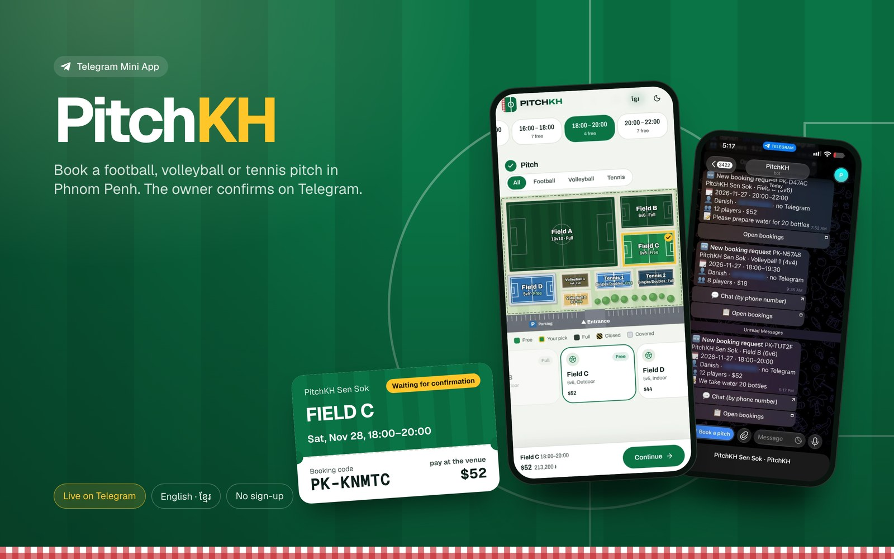
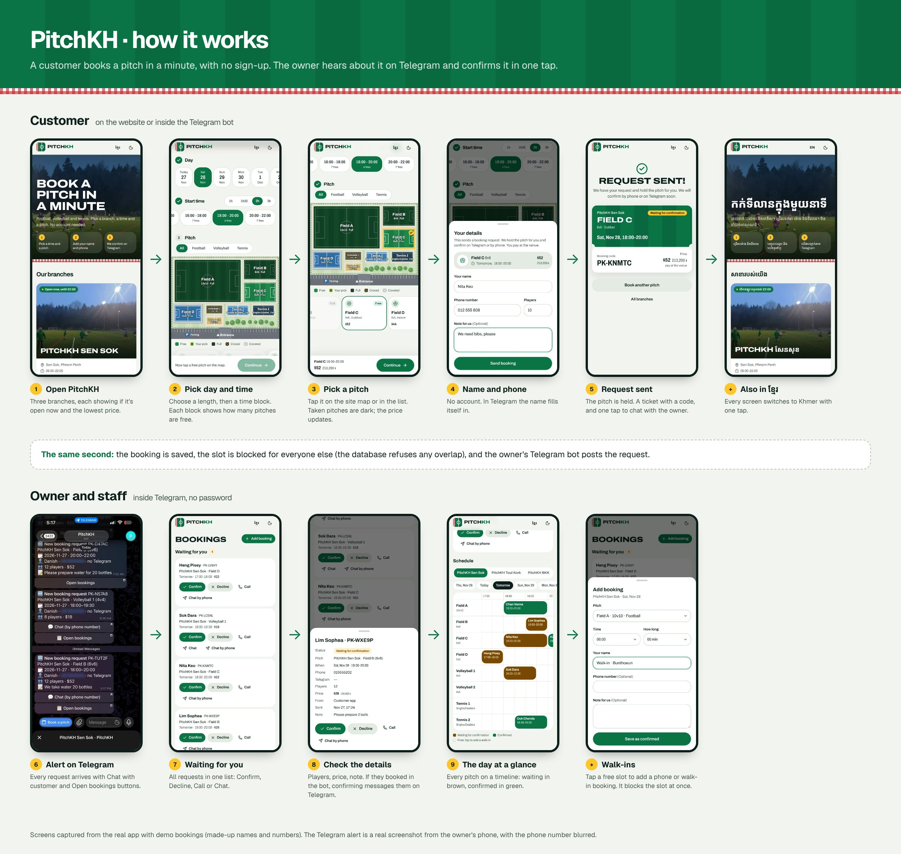

# Portfolio kit: PitchKH

Everything needed to add PitchKH to the portfolio (Danish_portfolio), in the same shape as the
Bookly case study. Captured from the real app with demo data on 27 Nov 2026.

PitchKH is used on phones (inside Telegram), so this kit has **phone screens only** and a cover
style of its own: the pitch itself, not a browser window.



## What's here

| Path | What it is | Size |
| --- | --- | --- |
| `cover/card.webp` | Project card cover (16:10): title, one line, two real phone screens, the booking ticket | 3200×2000 |
| `cover/banner.webp` | Wide banner for the top of the case study (2.4:1), no title | 3840×1600 |
| `cover/*.jpg` | Same covers at half size, for LinkedIn, README or slides | 1600×1000, 1920×800 |
| `cover/cover.source.html` | Source of both covers (`?mode=card` or `?mode=banner`, screenshot at 2×) | |
| `screens/m-*.webp` | 14 phone screens | 516×1118 (430×932 at 1.2×) |
| `pitchkh.portfolio.ts` | Ready-to-paste portfolio entry: pitch, facts, problem, what I built, screens, numbers, future plan | |
| `overview.jpg` | The whole user flow on one page, numbered, for a quick look | 2400 wide |
| `overview.source.html` | Source of `overview.jpg` | |

The phone size matches the Bookly phone screenshots already in the portfolio.

## The cover

- **Stage:** PitchKH's own mown-grass stripes in pitch green (`#0a7446` / `#09693f`), lit from the
  top-left like a floodlit evening game, with white chalk lines (halfway line, centre circle,
  penalty box) and the red krama check along the bottom, as in the app.
- **Type:** Geist, title "Pitch**KH**" with KH in floodlight yellow (`#ffc629`).
- **Product:** two real screenshots on phones standing on the pitch: the customer's pitch map,
  and behind it the owner's Telegram alert. Together they tell the whole idea.
- **The detail from the app:** the booking ticket stub (pitch-green top, tear line with notches,
  "Waiting for confirmation" badge and the booking code), exactly as the app draws it.
- **Banner:** three phones across the halfway line (time blocks, pitch map, Telegram alert), the
  ticket on the grass.

## How PitchKH works (the user flow)

### Customer (website or inside the Telegram bot)

1. **Open PitchKH** (`m-home`). Three branches, each with whether it's open now and the lowest price. No account, no sign-up.
2. **Branch page** (`m-branch`). Photo, address, hours, Directions and "Chat with us on Telegram".
3. **Pick a day and a time** (`m-time`). Today plus the next 13 days. Pick a length (1h, 1h30, 2h, 3h); the times become back-to-back blocks (2h: 06:00–08:00, 08:00–10:00 …) with how many pitches are free in each.
4. **Pick a pitch** (`m-pitch`). On a top-down plan of the venue or in the cards under it. Taken pitches are dark; the price for that time shows at once. A bar at the bottom keeps the pick and the price in view.
5. **Name and phone** (`m-form`). Plus the number of players and an optional note. Inside Telegram the name fills itself in. The same rules as the server check the form.
6. **Request sent** (`m-ticket`). The pitch is held for them. A ticket with a booking code, "pay at the venue", and one tap to send the owner a ready-made Telegram message with the booking details.
7. **In Khmer** (`m-home-km`, `m-pitch-km`). Every screen switches to Khmer with one tap.

**At the same moment:** the booking is saved and the slot is blocked for everyone else. The
database itself refuses two live bookings on the same pitch at overlapping times, so a double
booking can't happen, even if two people tap at the same second.

### Owner and staff (inside Telegram, no password)

8. **Alert on Telegram** (`m-telegram-alert`). The bot posts every request: branch, pitch, time, name, phone, players, price and note, with **Chat with customer** and **Open bookings** buttons.
9. **Waiting for you** (`m-staff-requests`). All open requests in one list with Confirm, Decline, Call and Chat. Staff are recognised by their signed Telegram identity, so there is nothing to log in to.
10. **Check the details** (`m-staff-booking`). Players, price, note, when it was sent. If the customer booked inside the bot, confirming or declining sends them a Telegram message.
11. **The day at a glance** (`m-staff-schedule`). Each branch's pitches on a timeline: waiting in brown, confirmed in green.
12. **Walk-ins** (`m-staff-walkin`). Tap a free slot to add a phone or walk-in booking; it's confirmed and blocks the slot at once.



## The story (also in `pitchkh.portfolio.ts`)

**Pitch.** Pick a time, tap a pitch on the map, send your name. The pitch is held for you, and the
owner confirms it on Telegram.

**The problem.** Booking a pitch here means messaging the owner and waiting. Nobody can see which
pitches are free, two teams can be promised the same slot, and the owner keeps the day in a chat
history.

**What I built.** A booking app inside Telegram: customers see what's free and book in a minute,
the owner gets every request as a message, and the day's pitches sit on one timeline.

**Facts row:** Solo · AI-assisted · Live on Telegram · English · ខ្មែរ · No sign-up.

**Numbers** (checked against the code on 27 Nov 2026): 24 pitches on the map (3 branches × 8) ·
3 branches · 104 automated tests passing (71 web + 33 shared) · 241 interface strings in both
English and Khmer. Other true numbers if you prefer: 7 REST endpoints, 4 game lengths, bookable 14
days ahead.

**Future development plan**
- Real branch details, photos and prices
- Deposit with KHQR to hold a slot
- Match-day reminders from the Telegram bot
- "My bookings" for customers, and weekly reports for the owner

## Screens

| Group | Screen | File |
| --- | --- | --- |
| Customer | Choose a branch | `m-home` |
| Customer | Branch page | `m-branch` |
| Customer | Day and time blocks | `m-time` |
| Customer | Pitch on the map | `m-pitch` |
| Customer | Name and phone | `m-form` |
| Customer | Request sent (ticket) | `m-ticket` |
| Customer | Home in Khmer | `m-home-km` |
| Staff | Alert on Telegram | `m-telegram-alert` |
| Staff | Waiting for you | `m-staff-requests` |
| Staff | Booking details | `m-staff-booking` |
| Staff | The day at a glance | `m-staff-schedule` |
| Staff | Walk-ins | `m-staff-walkin` |
| (extra) | All branches list | `m-branches` |
| (extra) | Pitch map in Khmer | `m-pitch-km` |

## Adding it to the portfolio

1. Copy `screens/*.webp` into `src/assets/projects/pitchkh/`, and `cover/card.webp` and
   `cover/banner.webp` next to the other covers.
2. Add the `pitchkh` image lookup to `src/lib/assets.ts` (the exact lines are at the top of
   `pitchkh.portfolio.ts`).
3. In `src/content/portfolio.ts`, add `"pitchkh"` to `Project["id"]`, paste the entry from
   `pitchkh.portfolio.ts` into `PROJECTS`, and map each `phone` name through the lookup
   (`phone: ASSETS.projects.pitchkhShot("m-home")`). The groups are `"Customer"` and `"Staff"`,
   which the `CaseStudy` type already allows.
4. Phone-only screens: every screen has `desktop: ""`. Make `desktop` optional in `CaseStudy`
   (`desktop?: string`) and, where the case study draws the laptop, render only the phone when
   `desktop` is empty.
5. The "How I built it" blocks (`steps`, `practices`, `challenges`, `lessons`) are empty on purpose.
   Hide a block when its list is empty, so no empty headings show.
6. The cover has its own style, so don't push it through the Bookly-style `ProjectCover` layout.
   Add a `pitchkh` entry to `THEMES` (any values; it keeps the type happy), then at the top of
   `ProjectCover` return the image for this project:

   ```tsx
   if (project.id === "pitchkh") {
     return (
       
     );
   }
   ```

   with `pitchkhCard` / `pitchkhBanner` imported from the two cover files.

## Notes

- **No real customer data.** Every name and number in the app screens is made-up demo data
  (Chan Vanna, Lim Sophea, Nita Keo …, numbers like 012 555 808), created on a local copy of the
  app with an in-memory store. Nothing was read from or written to the live database.
- **The Telegram alert** (`m-telegram-alert`) is the one screen that can't be captured locally: it's
  a real screenshot from the owner's phone of the bot's messages. The phone number in it is
  blurred; the name shown is the owner's own test booking.
- **Role line, kept honest:** the entry says "Built solo, working with an AI coding assistant"
  and the facts row says "Solo · AI-assisted". You designed and directed the product, made the
  decisions, set up the bot, Vercel and the database, and tested it on your phone; the AI wrote
  most of the code. Change the wording if you'd describe it differently.
- **Check before publishing:** `githubUrl` points to `github.com/danishsary8/pitchkh`. If the repo
  is private, remove the link or make it public first.
- While capturing, one small real bug showed up and was fixed on this branch: in Khmer, the big
  headlines' lower marks touched the next line (`apps/web/src/app/globals.css`). It is not live
  until this branch is merged.
